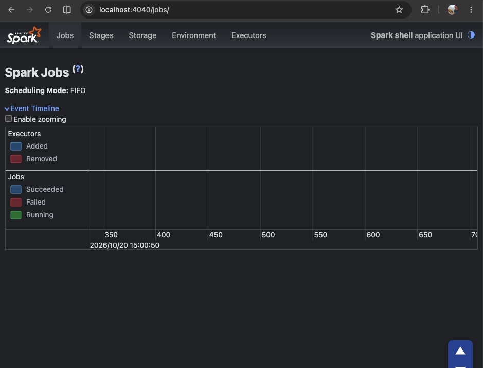

# Spark SQL Sandbox

This folder is a self-contained Spark SQL sandbox for trying the basics described on the Spark SQL page: DataFrames, SQL, grouping, aggregations, filtering, and simple transformations.

The examples below do not depend on any other project files or folders in this repository.

## Prerequisites

### 1) Install Java
Spark requires a Java runtime.

On macOS with Homebrew:

```bash
brew install openjdk@17
export JAVA_HOME=$(/usr/libexec/java_home -v 17)
```

On Linux (Ubuntu/Debian):

```bash
sudo apt-get update
sudo apt-get install -y openjdk-17-jdk
export JAVA_HOME=/usr/lib/jvm/java-17-openjdk
```

On Windows, install a JDK 17 package such as Temurin and add it to PATH.

### 2) Download Spark locally
Download a pre-built Spark tarball from the official Spark downloads page:

https://spark.apache.org/downloads.html

Recommended example:

```bash
cd ~
curl --fail --location --show-error --silent -o spark.tgz "https://downloads.apache.org/spark/spark-4.2.0/spark-4.2.0-bin-hadoop3.tgz"
tar -tzf spark.tgz >/dev/null
tar -xzf spark.tgz
mv spark-4.2.0-bin-hadoop3 spark
```

### 3) Configure environment variables
Add these to your shell profile (`~/.bashrc`, `~/.zshrc`, or PowerShell profile):

```bash
export SPARK_HOME="$HOME/spark"
export PATH="$SPARK_HOME/bin:$SPARK_HOME/sbin:$PATH"
export PYSPARK_PYTHON=python3
```

Then reload the shell:

```bash
source ~/.zshrc
# or: source ~/.bashrc
```

### 4) Verify the install

```bash
java -version
spark-shell --version
pyspark --version
```

If those commands run successfully, you are ready to try the samples.

### 5) If you see `UnsupportedClassVersionError`

If you see an error like:

```text
compiled by a more recent version of the Java Runtime (class file version 61.0)
```

it means Spark was built for Java 17+, but your shell is using an older Java (often Java 11).

Fix with:

```bash
# macOS
brew install openjdk@17
export JAVA_HOME=$(/usr/libexec/java_home -v 17)
export PATH="$JAVA_HOME/bin:$PATH"

# Ubuntu/Debian
sudo apt-get update
sudo apt-get install -y openjdk-17-jdk
export JAVA_HOME=/usr/lib/jvm/java-17-openjdk
export PATH="$JAVA_HOME/bin:$PATH"
```

Then re-run:

```bash
./setup_local_spark.sh
./run_python_demo.sh
```

## Quick start with the helper scripts

This folder includes helper scripts to install local prerequisites and run the examples inside a separate Python virtual environment.

### Before you start (important nuance)

If you are new to shell scripts: running `./setup_local_spark.sh` does **not** permanently change your current terminal environment.
That script runs in a child process, so exports inside it disappear when it exits.

That is why this README also shows how to add `JAVA_HOME` and `SPARK_HOME` to your shell profile (`~/.zshrc` or `~/.bashrc`).
The run scripts do a best-effort Java auto-detection, but permanent profile settings are still recommended.

### 1) Set up Python + Java + Spark

```bash
cd /path/to/spark_sql
./setup_local_spark.sh
```

This script will:
- create a local virtual environment at `.venv`
- install Python dependencies from `requirements.txt`
- install Java 17 if possible via Homebrew or apt-get
- verify that the active `java` is Java 17+ and print remediation steps if not
- download a local Spark distribution to `~/spark` if it is not already present
- download Spark from `downloads.apache.org` (or `SPARK_URL` if you set one)
- validate that the Spark download is a real `.tgz` before extracting
- print the environment variables you should export in your shell

After setup, if `java -version` still reports Java 11 in your terminal, run:

```bash
export JAVA_HOME=$(/usr/libexec/java_home -v 17)
export PATH="$JAVA_HOME/bin:$PATH"
java -version
```

You may want to explicitly specify the distribution file for Spark like so:

```bash
SPARK_URL="https://downloads.apache.org/spark/spark-4.2.0/spark-4.2.0-bin-hadoop3.tgz" ./setup_local_spark.sh
```

### 2) Run the Python example

```bash
cd /path/to/spark_sql
./run_python_demo.sh
```

This script activates the `.venv` environment, sets `SPARK_HOME` and `PYSPARK_PYTHON`, and runs:

```bash
python spark_sql_demo.py
```

It also performs a Java 17+ preflight check and prints actionable guidance if Java is too old.
If Java 17 is installed but not active in your shell PATH, the script auto-selects it and sets `JAVA_HOME` **inside the script process only**.
It does not switch your global terminal Java configuration.
It verifies that the selected Java is actually version 17+ and then prints the location/version before launching Spark.

This script:
- creates a SparkSession in local mode (`local[*]`)
- builds a small DataFrame from a list of records
- uses SQL to query it
- shows aggregations and filtered results

### 3) Run the Scala example

```bash
cd /path/to/spark_sql
./run_scala_demo.sh
```

This script runs:

```bash
spark-shell -i spark_sql_demo.scala
SparkSqlDemo.main(Array.empty[String])
:quit
```

It also performs a Java 17+ preflight check and prints actionable guidance if Java is too old.
If Java 17 is installed but not active in your shell PATH, the script auto-selects it and sets `JAVA_HOME` **inside the script process only**.
It does not switch your global terminal Java configuration.
It verifies that the selected Java is actually version 17+ and then prints the location/version before launching Spark.
It runs the Scala demo in **non-interactive mode** and exits automatically, so you do not get stuck at the `scala>` prompt.

This script does the same thing in Scala and creates a temporary view called `people`.

Common Scala startup messages and what they mean:
- `WARN Utils: ... resolves to a loopback address`  
  Usually safe for local testing. To silence it, run with `SPARK_LOCAL_IP=127.0.0.1 ./run_scala_demo.sh`.
- `WARN NativeCodeLoader: Unable to load native-hadoop library`  
  Usually safe for local testing; Spark falls back to built-in Java classes.
- If you still get `scala>` manually, run `SparkSqlDemo.main(Array.empty[String])` and then `:quit`.

## Manual run (without helper scripts)

If you prefer to run manually:

```bash
cd /path/to/spark_sql
python3 -m venv .venv
source .venv/bin/activate
python -m pip install --upgrade pip
python -m pip install -r requirements.txt
export SPARK_HOME="$HOME/spark"
export PATH="$SPARK_HOME/bin:$SPARK_HOME/sbin:$PATH"
export PYSPARK_PYTHON="$(which python)"
python spark_sql_demo.py
```

For Scala:

```bash
export SPARK_HOME="$HOME/spark"
export PATH="$SPARK_HOME/bin:$SPARK_HOME/sbin:$PATH"
spark-shell -i spark_sql_demo.scala
```

## Notes

- The examples are intentionally small and self-contained.
- They use `local[*]`, which runs Spark on your machine for experimentation only.
- For production-style runs, use a cluster manager or a larger Spark cluster setup.

## Example output (conceptually)

```text
+-----+-----------+--------+
|city |people_count|avg_age |
+-----+-----------+--------+
|Boston|2|31.0|
|New York|1|34.0|
+-----+-----------+--------+
```

## Example Spark UI




## Files in this sandbox

- `spark_sql_demo.py` — Python/PySpark example
- `spark_sql_demo.scala` — Scala/Spark SQL example
- `README.md` — setup and usage guide
